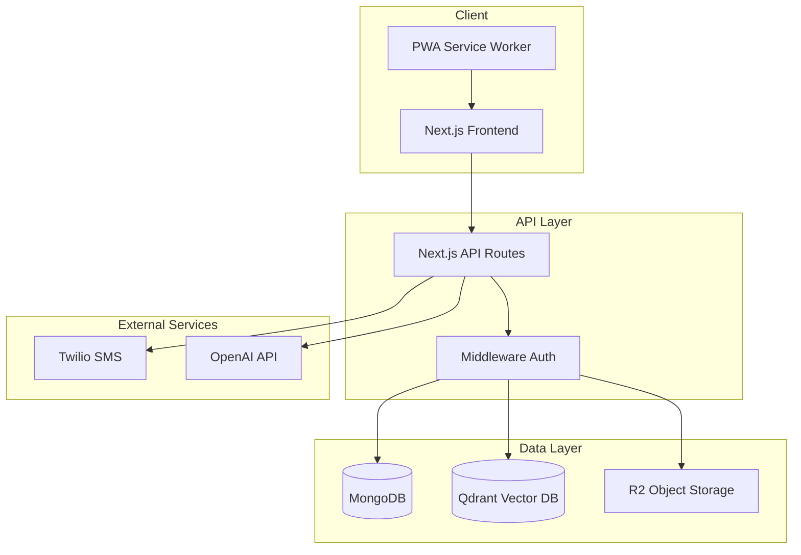

# Portfolio Improvement Plan for Austin Tech Market

**Goal:** Transform MCinv02 from a working app into a professional portfolio piece  
**Estimated Total Time:** 15-20 hours over 1-2 weeks  
**Target:** Entry-level to Junior Developer positions in Austin, TX

---

## Phase 1: Quick Wins (1-2 hours)
*Immediate credibility improvements*

### 1.1 Fix package.json
```json
{
  "name": "mcinv02-car-inventory",
  "description": "Full-stack car inventory management system for automotive dealerships",
  "version": "1.0.0",
  "author": "Your Name <your.email@example.com>",
  "license": "MIT",
  "repository": {
    "type": "git",
    "url": "https://github.com/yourusername/mcinv02"
  },
  "keywords": [
    "nextjs",
    "typescript",
    "mongodb",
    "car-inventory",
    "dealership",
    "pwa"
  ]
}
```

### 1.2 Add .nvmrc file
```
20.11.0
```

### 1.3 Add engines to package.json
```json
"engines": {
  "node": ">=20.0.0",
  "pnpm": ">=8.0.0"
}
```

### 1.4 Clean up root directory
Files to delete or move:
- [ ] `failing-tests.txt` → Delete (2MB of noise)
- [ ] `test-output.txt` → Delete
- [ ] `test-results.json` → Delete
- [ ] `build-trace.log` → Delete
- [ ] `TEST_FIX_SUMMARY.md` → Move to `/docs/archive/`
- [ ] `TEST_SUMMARY.md` → Move to `/docs/archive/`

### 1.5 Update .gitignore
Add:
```
# Test artifacts
test-output.txt
test-results.json
failing-tests.txt
build-trace.log

# IDE
.windsurf/
.cursor/

# Local env
.env.local
```

---

## Phase 2: README Overhaul (2-3 hours)
*First impression for recruiters*

### 2.1 New README.md Structure

```markdown
# MCinv02 - Car Inventory Management System

> A full-stack Progressive Web App for automotive dealerships to manage inventory, clients, deliveries, and marketing.

[](https://htg.lotlynx.app)
[](https://www.typescriptlang.org/)
[](https://nextjs.org/)


## Features

- 🚗 **Car Inventory** - Full CRUD with image management, status tracking, and audit logs
- 👥 **Client Management** - Customer database with interaction history and user isolation
- 📦 **Delivery Tracking** - Document management, recon tasks, and completion workflows
- 🔐 **OTP Authentication** - SMS-based login via Twilio with progressive rate limiting
- 🤖 **AI Matching** - OpenAI embeddings + Qdrant vector search for car-client matching
- 📱 **PWA** - Installable mobile app with offline support
- 🛡️ **RBAC** - Role-based access control (admin/manager/recon/user)

## Tech Stack

| Category | Technologies |
|----------|-------------|
| **Frontend** | Next.js 15, React 19, TypeScript, Tailwind CSS, shadcn/ui |
| **Backend** | Next.js API Routes, MongoDB/Mongoose, JWT Authentication |
| **Infrastructure** | Cloudflare R2 (S3), Twilio SMS, OpenAI API |
| **Testing** | Jest, React Testing Library |
| **DevOps** | GitHub Actions, Coolify (self-hosted PaaS) |

## Architecture

[Link to architecture diagram]

## Getting Started

### Prerequisites
- Node.js 20+
- pnpm 8+
- MongoDB instance
- Twilio account (for OTP)
- Cloudflare R2 bucket (for images)

### Installation
\`\`\`bash
git clone https://github.com/yourusername/mcinv02.git
cd mcinv02
pnpm install
cp .env.example .env.local
# Edit .env.local with your credentials
pnpm dev
\`\`\`

### Environment Variables
See `.env.example` for required variables.

## Project Structure

\`\`\`
├── app/
│   ├── api/           # 47 API routes
│   ├── components/    # 25+ React components
│   └── types.ts       # TypeScript interfaces
├── lib/               # Utilities (auth, validation, etc.)
├── models/            # 18 MongoDB schemas
├── __tests__/         # Jest test suites
└── docs/              # Technical documentation
\`\`\`

## Key Technical Decisions

1. **MongoDB over PostgreSQL** - Flexible schema for varied car specifications
2. **JWT in HttpOnly cookies** - Secure, stateless auth without localStorage XSS risk
3. **OpenAI embeddings** - Semantic search beyond keyword matching
4. **Progressive rate limiting** - Exponential backoff for OTP abuse prevention

## Testing

\`\`\`bash
pnpm test           # Run all tests
pnpm test:coverage  # With coverage report
\`\`\`

## License

MIT
```

### 2.2 Screenshots to Capture
Take screenshots of:
1. Dashboard (car list view)
2. Car detail page with images
3. Add/edit car form
4. Client management
5. Delivery tracking
6. Mobile responsive view

Save to: `docs/screenshots/`

### 2.3 Create .env.example
```env
# Database
MONGODB_URI=mongodb+srv://...

# Authentication
JWT_SECRET=your-secret-key-min-32-chars
TWILIO_ACCOUNT_SID=
TWILIO_AUTH_TOKEN=
TWILIO_VERIFY_SERVICE_SID=

# Storage
R2_ACCOUNT_ID=
R2_ACCESS_KEY_ID=
R2_SECRET_ACCESS_KEY=
R2_BUCKET_NAME=
R2_PUBLIC_URL=

# AI (Optional)
OPENAI_API_KEY=

# App
NEXT_PUBLIC_BASE_URL=http://localhost:3000
ALLOWED_ORIGIN=http://localhost:3000
```

---

## Phase 3: TypeScript Consistency (3-4 hours)
*Convert all .js files to strict TypeScript*

### 3.1 Files to Convert

**API Routes:**
- [ ] `app/api/cars/route.js` → `.ts`
- [ ] `app/api/cars/[id]/route.js` → `.ts`
- [ ] `app/api/clients/[id]/interactions/route.js` → `.ts`

**Models:**
- [ ] `models/Car.js` → Already have `.ts` version, delete `.js`
- [ ] `models/Client.js` → Create `.ts` version
- [ ] `models/Document.js` → Create `.ts` version
- [ ] `models/Phone.js` → Create `.ts` version
- [ ] `models/Picture.js` → Create `.ts` version

**Lib:**
- [ ] `lib/s3.js` → `.ts`

### 3.2 TypeScript Strict Mode
Update `tsconfig.json`:
```json
{
  "compilerOptions": {
    "strict": true,
    "noImplicitAny": true,
    "strictNullChecks": true,
    "noUnusedLocals": true,
    "noUnusedParameters": true
  }
}
```

### 3.3 Fix `any` Types
Search and replace common patterns:
- `(a as any).createdAt` → proper typing
- `(payload as any).phone` → extend JWTPayload interface
- Function parameters without types

---

## Phase 4: CI/CD Setup (1-2 hours)
*Automated quality gates*

### 4.1 GitHub Actions Workflow
Create `.github/workflows/ci.yml`:

```yaml
name: CI

on:
  push:
    branches: [main, develop]
  pull_request:
    branches: [main]

jobs:
  quality:
    runs-on: ubuntu-latest
    
    steps:
      - uses: actions/checkout@v4
      
      - uses: pnpm/action-setup@v2
        with:
          version: 8
          
      - uses: actions/setup-node@v4
        with:
          node-version: '20'
          cache: 'pnpm'
          
      - name: Install dependencies
        run: pnpm install --frozen-lockfile
        
      - name: Type check
        run: pnpm typecheck
        
      - name: Lint
        run: pnpm lint
        
      - name: Test
        run: pnpm test:ci
        env:
          NODE_ENV: test
          
      - name: Upload coverage
        uses: codecov/codecov-action@v3
        with:
          files: ./coverage/lcov.info
          fail_ci_if_error: false

  build:
    runs-on: ubuntu-latest
    needs: quality
    
    steps:
      - uses: actions/checkout@v4
      
      - uses: pnpm/action-setup@v2
        with:
          version: 8
          
      - uses: actions/setup-node@v4
        with:
          node-version: '20'
          cache: 'pnpm'
          
      - name: Install dependencies
        run: pnpm install --frozen-lockfile
        
      - name: Build
        run: pnpm build
        env:
          SKIP_ENV_VALIDATION: true
```

### 4.2 Add Badges to README
```markdown
[](https://github.com/yourusername/mcinv02/actions)
[](https://codecov.io/gh/yourusername/mcinv02)
```

---

## Phase 5: Code Quality (2-3 hours)
*Professional code standards*

### 5.1 Remove Debug Artifacts
Search and clean:
```bash
# Find all console.log statements
grep -r "console.log" app/ lib/ --include="*.ts" --include="*.tsx"

# Find all console.warn statements (keep security-related ones)
grep -r "console.warn" app/ lib/ --include="*.ts" --include="*.tsx"
```

**Keep:** Security logging, error logging in catch blocks  
**Remove:** Debug statements, commented code, `// TODO` without tracking

### 5.2 Add Proper Error Boundaries
Create `app/components/error-boundary.tsx`:
```typescript
'use client'

import { Component, ReactNode } from 'react'

interface Props {
  children: ReactNode
  fallback?: ReactNode
}

interface State {
  hasError: boolean
}

export class ErrorBoundary extends Component<Props, State> {
  constructor(props: Props) {
    super(props)
    this.state = { hasError: false }
  }

  static getDerivedStateFromError(): State {
    return { hasError: true }
  }

  componentDidCatch(error: Error, info: React.ErrorInfo) {
    console.error('ErrorBoundary caught:', error, info)
  }

  render() {
    if (this.state.hasError) {
      return this.props.fallback || <div>Something went wrong</div>
    }
    return this.props.children
  }
}
```

### 5.3 ESLint Configuration
Update `eslint.config.mjs` to enforce:
- No unused variables
- No `any` types (warning → error)
- Consistent return types
- Import ordering

### 5.4 Add Prettier (optional but recommended)
```bash
pnpm add -D prettier eslint-config-prettier
```

Create `.prettierrc`:
```json
{
  "semi": false,
  "singleQuote": true,
  "tabWidth": 2,
  "trailingComma": "es5"
}
```

---

## Phase 6: Testing Enhancement (3-4 hours)
*Demonstrate testing competency*

### 6.1 Critical Path Integration Test
Create `__tests__/integration/car-lifecycle.test.ts`:

```typescript
/**
 * Integration test: Full car lifecycle
 * 1. Create car with images
 * 2. Update car status to reserved
 * 3. Verify delivery auto-created
 * 4. Complete delivery
 * 5. Verify car status is sold
 */
describe('Car Lifecycle Integration', () => {
  it('should complete full car journey from creation to sale', async () => {
    // Implementation
  })
})
```

### 6.2 Authentication Flow Test
Create `__tests__/integration/auth-flow.test.ts`:
- Test OTP send
- Test OTP verify
- Test session creation
- Test protected route access
- Test rate limiting

### 6.3 Coverage Targets
Aim for:
- **Statements:** 70%+
- **Branches:** 60%+
- **Functions:** 70%+
- **Lines:** 70%+

### 6.4 Add Test Documentation
Create `__tests__/README.md`:
```markdown
# Test Suite

## Running Tests
\`\`\`bash
pnpm test              # All tests
pnpm test:watch        # Watch mode
pnpm test:coverage     # With coverage
\`\`\`

## Test Structure
- `__tests__/api/` - API route tests
- `__tests__/components/` - React component tests
- `__tests__/lib/` - Utility function tests
- `__tests__/integration/` - End-to-end flows

## Mocking Strategy
- MongoDB: mongodb-memory-server
- External APIs: Jest mocks
- Auth: Mock session tokens
```

---

## Phase 7: Demo Environment (1-2 hours)
*Show, don't tell*

### 7.1 Seed Script
Create `scripts/seed-demo-data.ts`:
```typescript
// Creates sample data:
// - 10-15 cars (various statuses)
// - 5-8 clients
// - 3-4 active deliveries
// - Sample notifications
```

### 7.2 Demo Account
Create a read-only demo account:
- Phone: Demo number that auto-verifies
- Role: `user` (not admin)
- Pre-populated data visible

### 7.3 Demo Instructions
Add to README:
```markdown
## Live Demo

**URL:** https://htg.lotlynx.app/auth/login
**Demo Phone:** +1 555-DEMO-XXX (auto-verifies)

*Note: Demo account is read-only. Contact me for full access.*
```

---

## Phase 8: Documentation Polish (2-3 hours)
*Technical communication skills*

### 8.1 Architecture Diagram
Create `docs/ARCHITECTURE.md` with Mermaid diagrams:



### 8.2 API Documentation
Create `docs/API.md` or use OpenAPI:
- List all endpoints
- Request/response examples
- Authentication requirements
- Rate limits

### 8.3 Decision Records
Create `docs/decisions/` folder with ADRs:
- `001-mongodb-over-postgresql.md`
- `002-jwt-over-sessions.md`
- `003-otp-over-password.md`
- `004-qdrant-for-vector-search.md`

ADR Template:
```markdown
# ADR-001: MongoDB over PostgreSQL

## Status
Accepted

## Context
Need a database for car inventory with flexible schemas.

## Decision
Use MongoDB with Mongoose ODM.

## Consequences
- ✅ Flexible schema for varied car specs
- ✅ JSON-like documents match API responses
- ⚠️ No strict relational integrity
- ⚠️ Aggregation pipelines can get complex
```

---

## Timeline Recommendation

| Week | Focus | Hours |
|------|-------|-------|
| **Week 1** | Phases 1-3 (Quick wins, README, TypeScript) | 8-10 |
| **Week 2** | Phases 4-6 (CI/CD, Quality, Testing) | 6-9 |
| **Week 3** | Phases 7-8 (Demo, Docs) + Polish | 4-6 |

---

## Interview Prep Talking Points

After completing these improvements, be ready to discuss:

1. **"Walk me through the architecture"** → Use your diagram
2. **"How does authentication work?"** → JWT + OTP + rate limiting
3. **"How did you handle image uploads?"** → Sharp processing → R2 storage
4. **"What would you do differently?"** → PostgreSQL for relations, Redis for sessions
5. **"How did you test this?"** → Jest + RTL + mongodb-memory-server
6. **"What was the hardest bug?"** → Pick one from your docs (OTP login fix, image format fix, etc.)

---

## Success Metrics

You're ready to apply when:
- [ ] README looks professional with screenshots
- [ ] All files are TypeScript
- [ ] CI passes on every push
- [ ] Test coverage > 70%
- [ ] Demo environment works reliably
- [ ] You can explain every technical decision
- [ ] You've practiced the interview talking points

Good luck! 🚀
