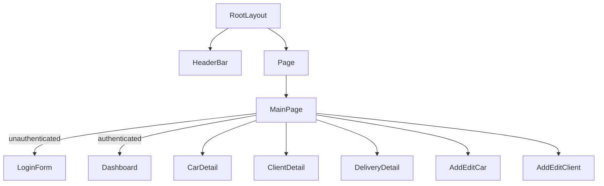
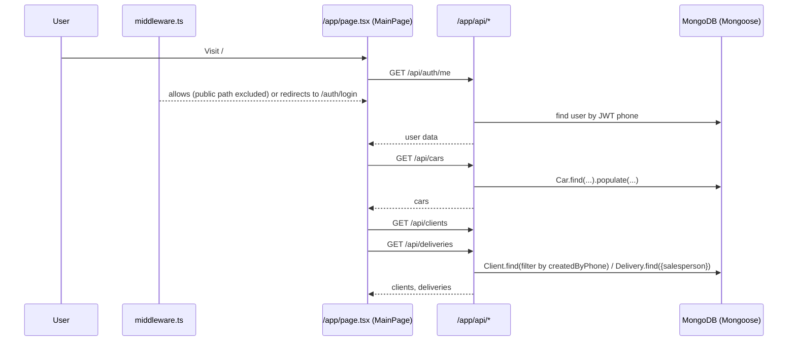
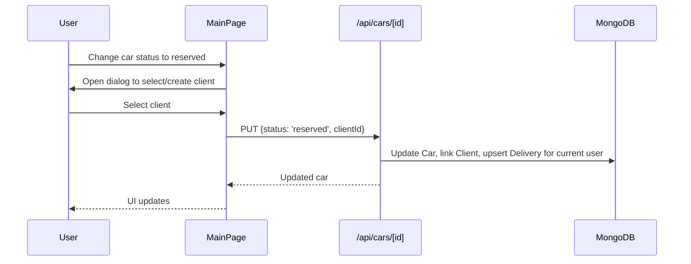

### 6.8 TODOs (user isolation)
- List/Create: `GET/POST /api/todos` require auth, infer current user id from JWT, and operate only on that user’s records.
- Update/Delete: `PUT/DELETE /api/todos/[id]` enforce ownership (filter by `{ _id, user }`).
- Admins do not get cross-user access here by default; this is strictly per-user.

# MCinv02 – Architecture & Wiring Overview

This document provides a complete architectural map of the MCinv02 Next.js mobile web app. It explains how the application is structured, how pages and components interact, how data flows through API routes and models, and what dependencies are used. Use this as the source of truth when making changes, so that updates in one area don’t unintentionally break others.

- Repo root: `c:/LLM/mcinv02/`
- Framework: Next.js App Router (`/app/`)
- Runtime: Node.js for API routes (with some edge-safe middleware constraints)
- Database: MongoDB via Mongoose
- Auth: Phone-based OTP via Twilio Verify + JWT cookie (`session_token`)
- UI: Tailwind, Radix UI, shadcn/ui-like building blocks

---

## 1) High-level Architecture

- __App Router__: Routes live under `app/`. Server routes are under `app/api/...`. UI pages and components live under `app/...` and `components/`.
- __Middleware__: `middleware.ts` enforces JWT presence and OTP-day freshness, injects user headers, and handles admin gating and redirects.
- __Client-first dashboard__: Root route (`app/page.tsx`) renders `MainPage` which controls authentication checks and lazy-loads heavy components (`Dashboard`, `CarDetail`, `ClientDetail`, `DeliveryDetail`, editors).
  - The Reserve client selection dialog is owned and rendered by `MainPage` in every view branch (Dashboard, Car Detail, Client Detail, Delivery Detail, Editors). Selecting `Reserved` from either the Dashboard list or the Car Detail page triggers this dialog immediately.

### Mobile Navigation Model (Unified)
- A single, scrollable bottom bar is used on mobile/tablet. It contains:
  - Stock filters first: `All`, `In-Stock`, `Coming`, `Reserved`, `Sold`, `Demo`.
  - Global sections after filters: `Clients`, `Delivery`, `Notifications`, `TODO` (if enabled for the user), and `Admin` (if role).
- The bar hides when not in use and is revealed via swipe-up or tap. It respects safe-area insets and uses generous horizontal padding to avoid clipping.
- The bar’s wrapper uses `pointer-events: none` while chips/buttons use `pointer-events: auto`, so content beneath remains scrollable.
- The floating circular back button has been removed from dashboard/list views (Stock, Clients, Delivery). Back navigation remains in detail/editor headers only.
- The bottom drawer pull handle has been removed and the bottom bar padding reduced to increase content height.
 - Chips include subtle icons per section/filter (car, check, clock, bookmark, tag, wand, users, truck, bell, calendar, admin shield). Active state uses a solid highlight; inactive uses a light glass outline.

### Mobile Dashboard: FAB vs. Scroll
- The main Stock list scrolls within a viewport that also hosts a floating “Add” FAB near the bottom-right.
- To ensure the area under/around the FAB remains scrollable on mobile:
  - The FAB’s immediate wrapper/container should use `pointer-events: none;` so it does not intercept scroll/touch events.
  - The actionable element (the button itself) should use `pointer-events: auto;` so taps on the button still work. This lets the rest of the area beneath remain scrollable.
  - Provide bottom padding on the scroll container at least equal to the FAB’s diameter plus spacing, e.g. `padding-bottom: calc(6.5rem + env(safe-area-inset-bottom));` to prevent the FAB from visually overlapping and blocking the last items.
  - Keep the FAB’s z-index above content for visibility, but do not wrap it in other positioned elements that capture gestures.
  - Respect safe-area insets on iOS using `env(safe-area-inset-bottom)` so neither the FAB nor the padding collides with system UI.
- This pattern preserves the FAB’s click/tap behavior while keeping the list beneath fully scrollable.
- __Data layer__: MongoDB models in `models/` (`Car`, `Client`, `Delivery`, `User`, etc.) via a cached `mongoose` connection (`lib/mongodb.ts`).
- __API__: Next.js route handlers in `app/api/...` implement CRUD and domain workflows (cars, clients, deliveries, auth, users, uploads, cron).
- __User isolation__: Implemented in API routes based on JWT claims and role. Clients are filtered by `createdByPhone`; deliveries are filtered by `salesperson` (current user id).
- __File storage__: Vehicle images to R2/S3 via `@aws-sdk/client-s3` and `lib/s3.js` (Cloudflare R2-compatible).

---

## 2) Routing Structure (App Router)

Key pages and layout:
- `app/layout.tsx`: Root layout. Provides `ThemeProvider`, `Toaster`, and `HeaderBar`.
- `app/page.tsx`: Entry page. Renders `MainPage`.
- `app/auth/login/page.tsx`: Login flow via phone + OTP.
- `app/profile/page.tsx`: Profile editing for the current user.
- `app/admin/page.tsx`: Admin panel (user management). Admin-only via middleware.

API routes (selected):
- Auth
  - `app/api/auth/otp/send/route.ts`
  - `app/api/auth/otp/verify/route.ts`
  - `app/api/auth/me/route.ts`
  - `app/api/auth/logout/route.ts`
- Cars
  - `app/api/cars/route.js` (GET list, POST create)
  - `app/api/cars/[id]/route.js` (GET single, PUT status/details, DELETE)
- Clients
  - `app/api/clients/route.js` (GET list w/ isolation, POST create)
  - `app/api/clients/[id]/route.js` (GET/PUT/DELETE with isolation)
  - `app/api/clients/[id]/interactions/route.js` (client interactions)
- Deliveries
  - `app/api/deliveries/route.ts` (GET my deliveries, POST upsert by car)
  - `app/api/deliveries/[id]/route.ts` (GET/PUT my delivery)
- Users
  - `app/api/admin/users/route.ts` (admin list/create)
  - `app/api/users/route.js`, `app/api/users/[id]/route.js` (legacy/general)
- TODOs
  - `app/api/todos/route.ts` (GET my todos filtered by date, POST create)
  - `app/api/todos/[id]/route.ts` (PUT update, DELETE) — all routes enforce ownership via JWT user id
  - Entries capture optional HH:mm `time` metadata, used to display precise reminders in the UI.
- Misc
  - `app/api/uploads/route.ts` (file uploads)
  - Test/health routes under `app/api/test*/`

Middleware:
- `middleware.ts` – protects routes except public assets, `/auth`, `/api/auth`, `/docs`. Enforces daily OTP by checking `otpDay`. Injects `x-user-phone` and `x-user-role` headers for downstream routes.

Note on dynamic route param access:
- Dynamic API routes call `await request.blob()` (or `await request.clone().blob()`) before accessing `params` due to a Next.js quirk. Examples: `app/api/cars/[id]/route.js`, `app/api/deliveries/[id]/route.ts`, `app/api/clients/[id]/route.js`.

---

## 3) Component Tree & Interaction

Top-level components:
- `app/components/header-bar.tsx` — persistent top bar. Fetches `/api/auth/me`, shows profile and admin link.
- `app/components/main-page.tsx` — orchestrator. Handles:
  - Auth check via `/api/auth/me` (state: `isAuthenticated`, `authChecked`).
  - Lazy-loading and switching between: `Dashboard`, `CarDetail`, `ClientDetail`, `DeliveryDetail`, `AddEditCar`, `AddEditClient`.
  - Data loading strategy: fetch cars first, then parallel fetch of clients and deliveries.
  - Reserve flow with a linking dialog to select/create client, then updating car status.
- `app/components/dashboard.tsx` — mobile-first dashboard with two nav layers:
  - Top-level tabs: Stock, Clients, Delivery (+ Admin toggle).
  - Secondary tabs for Stock: all/in-stock/coming/reserved/sold/demo.
  - Lists cars/clients/deliveries with status badges and quick actions.
  - Also renders Notifications and a basic TODO calendar (if enabled per user).
- `app/components/car-detail.tsx` — gallery, status change, share flow, audit insights.
- `app/components/delivery-detail.tsx` — delivery prep, client linking, recon tasks, licensing, doc checklist and uploads (local IndexedDB or R2 uploads).
- `app/components/add-edit-car.tsx`, `app/components/add-edit-client.tsx` — editors (FormData for car, JSON for client). 
- `app/components/client-detail.tsx` — client info and linked cars.
- UI primitives live under `components/ui/*`.

Interaction highlights:
- `MainPage` owns the state for selections and modals; renders one heavy view at a time.
- Heavy components are lazy-loaded and wrapped in Suspense loaders.
- State is local React state and effects; there’s no global context store or Redux.

---

## 4) Data Models (Mongoose)

- `models/User.ts`
  - Fields: `phone`, `role` (`admin|user|manager`), `isAuthorized`, `department`, `profile{firstName,lastName,email,avatar}`, OTP fields, timestamps.
  - Methods: `isTestNumber()`.
  - Feature flags: `matchingEnabled` and `todoEnabled` (per-user access to TODO tab).
- `models/Car.ts/js`
  - Typical fields: `make, model, year, price, kilometers, color, transmission, licensePlate, vin, images[] -> Picture, owner -> Client, status ('in-stock'|'coming'|'reserved'|'sold'|'demo'), auditLog[]`.
  - Index handling in `app/api/cars/route.js` ensures partial unique index for `licensePlate`.
- `models/Client.js`
  - Fields: `firstName, lastName, email, phone, createdByPhone, cars[]`, etc.
- `models/Delivery.ts`
  - Fields: `car -> Car, client -> Client, salesperson -> User, deliveryDate, financeBank, licensing{done,notes}, reconTasks[], additionalDocs{trade_in_natis, source_of_funds, ubo_form}, docs[], status, auditLog[]`.
- Others: `models/Picture.js`, `models/Document.js`, `models/Session.ts`, `models/Phone.js`.

- `models/Todo.ts`
  - Fields: `user -> User`, `date` (day-level), `title`, timestamps. All queries are user-isolated.

DB connection:
- `lib/mongodb.ts` exposes `connect()` with a cached connection across hot reloads.

---

## 5) State Management

- Local component state via React hooks (`useState`, `useEffect`, `useMemo`, etc.).
- No shared React Context or Redux store.
- Side-effects (data fetching) are colocated in `MainPage` and detail views.
- Optimizations: all heavy views are lazy-loaded; only one main view is mounted at a time.

---

## 6) Data Flows & Interactions

### 6.1 Authentication (Phone OTP)
- Login page `app/auth/login/page.tsx` and `app/components/login-form.tsx` (used in `MainPage` unauthenticated view) handle:
  - Send: `POST /api/auth/otp/send` with phone in E.164 (ZA default, normalized via `libphonenumber-js`). Test accounts return a `testOtp`.
  - Verify: `POST /api/auth/otp/verify` (handles test OTPs directly or Twilio Verify for real users). On success:
    - Creates a JWT with `phone`, `userId`, `role`, `otpDay` and sets `session_token` httpOnly cookie.
    - Creates/rotates a `Session` document with `deviceType` and activity tracking.
- Me/Profile: `GET/PUT /api/auth/me` reads cookie, verifies JWT, loads/saves profile fields. If phone is changed, client is instructed to re-auth.
  - Response includes `todoEnabled` which governs whether the TODO tab is shown.
- Logout: `POST /api/auth/logout` to clear session client-side usages, UI redirects to `/auth/login`.

Middleware `middleware.ts` effects:
- Protects routes except listed public paths.
- Verifies `session_token` with `jose.jwtVerify`.
- Enforces daily OTP by comparing `payload.otpDay` with today in `Africa/Johannesburg`.
- Injects `x-user-phone` and `x-user-role` headers to downstream route handlers.
- Redirects non-admin users away from `/admin`.

### 6.2 Dashboard Data Fetching
- In `app/components/main-page.tsx`:
  - `checkAuth` calls `/api/auth/me` on mount; toggles `isAuthenticated` and saves current user name/phone.
  - `fetchData` loads:
    - `GET /api/cars` first (fast path for initial rendering),
    - then `GET /api/clients` and `GET /api/deliveries` in parallel.
  - When switching to the Delivery tab, data is refreshed to reflect current state.

### 6.3 Cars
- List: `GET /api/cars` populates `owner` and `images`.
- Create: `POST /api/cars` expects `multipart/form-data` with images; uploads to R2 and creates `Picture` entries; records audit log.
- Update (status-only): `PUT /api/cars/[id]` with JSON `{ status, clientId? }`:
  - Logs audit change.
  - If `status === 'reserved'` and the current user is known, optionally link `clientId` (enforced by role and ownership) and upsert a `Delivery` for that user+car.
  - If changing away from `reserved` (to any other status), deletes any `Delivery` records for that car, removing it from the Delivery page along with its embedded documents.
  - Additionally, when leaving `reserved`, the car is unlinked from the client: `car.owner` is cleared and the car id is `$pull`ed from the client's `cars` list to ensure the client’s Associated Cars no longer shows the vehicle.
  - The Reserve client selection dialog is globally mounted by `MainPage`, so it opens immediately regardless of whether the status change occurs from the Dashboard or the Car Detail view.
- Update (full details): `PUT /api/cars/[id]` with `multipart/form-data` handles images (new + existing + ordering), logs field changes precisely, and saves.
- Delete: `DELETE /api/cars/[id]`.

### 6.4 Clients (user isolation)
- List: `GET /api/clients` uses JWT to infer `role` and `phone`. Non-privileged users see clients filtered by `createdByPhone`.
- Create: `POST /api/clients` normalizes phone numbers and sets `createdByPhone` to the creator’s phone.
- Get/Update/Delete: `app/api/clients/[id]/route.js` enforces ownership for non-privileged users.

### 6.5 Deliveries (user isolation)
- List: `GET /api/deliveries` resolves current user id from JWT/cookie and returns deliveries filtered by `salesperson`.
- Upsert by car: `POST /api/deliveries` links a car to the current user’s delivery, with audit entry.
- Get/Update by id: `app/api/deliveries/[id]/route.ts` enforces `salesperson` isolation and writes detailed audit entries for every change (including recon task diffs).

### 6.6 File uploads
- `app/api/uploads/route.ts` accepts FormData `file`. When `NEXT_PUBLIC_LOCAL_DOCS_ONLY=true`, `delivery-detail.tsx` stores files to IndexedDB using `lib/idb-docs.ts`.

---

### 6.7 Client detail population
- When a client is selected in `app/components/main-page.tsx`, the app fetches `/api/clients/[id]` to load a fully populated client record that merges cars from both `Client.cars` and Delivery links for that client (see `app/api/clients/[id]/route.js`).
- The `ClientDetail` view (`app/components/client-detail.tsx`) renders the associated cars list using stable keys and guards against unpopulated string IDs. If a car reference is a string ID, it will render a placeholder and disable click navigation for that item until data is populated.

---

## 7) Dependencies & Integration

See `package.json` for full versions. Key runtime deps:
- `next@15.2.4`, `react@^19`, `react-dom@^19`
- UI: `@radix-ui/*` components, `lucide-react`, `tailwindcss@^3.4.17`, `tailwindcss-animate`, `class-variance-authority`, `clsx`
- Forms/validation: `react-hook-form`, `zod`, `@hookform/resolvers`
- Data/Charts: `recharts`, `react-day-picker`, `embla-carousel-react`, `react-resizable-panels`
- Auth/Security: `jose`, `uuid`
- Phone: `libphonenumber-js`
- Twilio: `twilio` (Verify API)
- Database: `mongoose@^8.16.0`, `mongodb@^6.17.0`
- Storage: `@aws-sdk/client-s3`
- Theming: `next-themes`
- Misc: `sonner` (toasts), `vaul`, `cmdk`

Dev deps:
- Jest + React Testing Library stack, TypeScript `^5`, Tailwind/PostCSS, `dotenv`.

Package manager: pnpm (per workspace preference).

---

## 8) User Journeys

1) __Login__
- User visits `/auth/login` (or is redirected there by `middleware.ts`).
- Enters phone; `POST /api/auth/otp/send` sends OTP (Twilio) or returns `testOtp`.
- Enters OTP; `POST /api/auth/otp/verify` sets `session_token` and redirects back.

2) __Dashboard load__
- `MainPage` checks `/api/auth/me`; if ok, loads cars, then clients and deliveries in parallel.
- `Dashboard` shows Stock tab by default; users change filters or switch to Clients/Delivery.

3) __Reserve flow__
- On status → `reserved`, `MainPage` opens a dialog to select or create a client.
- On submit, `PUT /api/cars/[id]` with `{ status:'reserved', clientId }` links client, updates car owner, and upserts a delivery for the current user.

4) __Delivery prep__
- From Dashboard Delivery tab, user selects a delivery to open `DeliveryDetail`.
- User sets date, finance, licensing, recon tasks, uploads docs. `PUT /api/deliveries/[id]` persists granular changes with detailed audit logs.

5) __Profile update__
- `/profile` loads `/api/auth/me`. PUT back to the same route saves changes; phone change triggers a re-auth requirement.

6) __Admin panel__
- `/admin` is gated by middleware; non-admins redirected to `/`. Admin can manage users via `CreateUserForm`, `UserList` (see `app/components/admin/*`).

---

## 9) Performance & UX Practices

- Heavy views are dynamically imported in `app/components/main-page.tsx`:
  - `Dashboard`, `CarDetail`, `ClientDetail`, `DeliveryDetail`, `AddEditCar`, `AddEditClient`.
  - All wrapped in `Suspense` with a spinner.
- Next config (`next.config.mjs`):
  - `experimental.optimizePackageImports` for Radix/lucide.
  - `compress: true`, image `unoptimized: true` for predictable edge/deploys.
  - `serverExternalPackages: ['mongoose']` for server bundling.
- Fetch strategy: cars first, then clients+deliveries in parallel (see `fetchData` in `main-page.tsx`).
- Mobile-first dashboard with bottom-drawer navigation, touch gestures, and glass UI.

---

## 10) Security & Access Controls

- JWT cookie (`session_token`) is httpOnly with `sameSite: 'lax'` set in OTP verify route.
- `middleware.ts` enforces:
  - Auth for all non-public routes.
  - Daily OTP re-validation using `otpDay`.
  - Role-based admin access (`/admin`).
  - Propagates `x-user-phone` and `x-user-role` to APIs for auditing and business logic.
- API routes additionally verify JWT from cookies (`/api/clients`, `/api/auth/me`, deliveries routes) and apply user isolation rules.
- TODO routes strictly scope by `user` id from JWT. Admin Users API controls access with the per-user flag `todoEnabled`.
- Shared helpers in `lib/auth-session.ts` expose `requireSession()`, `getSession()`, and `isPrivileged()` to ensure all authenticated routes share the same parsing and validation logic.
- Client request APIs rely on `lib/validation/client-request.ts` for Zod-based payload validation, input normalization, and sanitization before embeddings are refreshed.
- Rate limiting helpers (`lib/rate-limit.ts`) protect mutation-heavy endpoints (client requests, match state changes) to guard against abuse.
- Match status transitions (`/api/matches/[id]/view|contacted|dismiss`) append audit entries (see `Match.auditLog`) for traceability.

---

## 11) Diagrams (Text-based)

### Component hierarchy (simplified)

### Data flow (auth + data)

### Reserve flow

---

## 12) Conventions & Notes

- __Dynamic route params__: call `await request.blob()` before reading `params`.
- Prefer the `withParams()` helper from `lib/with-params.ts`, which handles the blob read and unwraps `params` for you.
- __React components__: use `.tsx` (TypeScript) for new components.
- __Package manager__: use `pnpm` for installing/running scripts.
- __Status values__: `in-stock | coming | reserved | sold | demo`. Use `app/components/status-utils.tsx` for label/color helpers.
- __Audit logs__: cars and deliveries both track human-readable audit entries.
- __User isolation__: clients by `createdByPhone`, deliveries by `salesperson`.

---

## 13) Local Development

- Install dependencies: `pnpm install`
- Run dev server: `pnpm run dev`
- Tests: `pnpm test` / `pnpm test:watch`

Environment variables (non-exhaustive):
- `MONGODB_URI`
- `JWT_SECRET`
- `TWILIO_ACCOUNT_SID`, `TWILIO_AUTH_TOKEN`, `TWILIO_VERIFY_SERVICE_SID`
- `R2_BUCKET_NAME`, `R2_PUBLIC_URL`, R2 credentials for `@aws-sdk/client-s3`
- `NEXT_PUBLIC_LOCAL_DOCS_ONLY` (true to keep uploads local via IndexedDB)

---

## 14) Safe-change Guide

When updating features, use these anchors:
- Dashboard behavior and nav: `app/components/dashboard.tsx`.
- Data fetching & view switching: `app/components/main-page.tsx`.
- Car workflows: `app/api/cars/*`, `models/Car.*`, `app/components/car-detail.tsx`, `app/components/add-edit-car.tsx`.
- Client workflows: `app/api/clients/*`, `models/Client.js`, `app/components/add-edit-client.tsx`, `app/components/client-detail.tsx`.
- Delivery workflows: `app/api/deliveries/*`, `models/Delivery.ts`, `app/components/delivery-detail.tsx`.
- Auth and sessions: `app/api/auth/*`, `middleware.ts`, `models/Session.ts`, `app/auth/login/page.tsx`.
- Header/profile: `app/components/header-bar.tsx`, `app/profile/page.tsx`.

Before changing API contracts:
- Update both the route handlers and the calling components in `MainPage`, detail views, and editors.
- Mind user isolation (filters) and audit logging.
- Preserve the `await request.blob()` pattern for dynamic route params.

---

## 15) Improvements & Opportunities

- __Type safety across server routes__: Convert JS route files to TS where feasible (`app/api/cars/*.js`, `app/api/clients/*.js`, etc.) for stronger typing.
- __Centralize auth utilities__: Factor common JWT/cookie parsing into a helper to avoid duplication across routes.
- __Rate limiting / Abuse protection__: Add rate limiting for OTP endpoints to protect from spam.
- __Progressive image handling__: Consider next/image or responsive images where possible; currently `images.unoptimized: true` for simplicity.
- __Better error toasts__: Surface API errors in the UI consistently using `sonner`.
- __E2E tests__: Add Playwright tests for login, reserve flow, and delivery edits.
- __Loading skeletons__: Replace generic spinners with skeletons to reduce layout shifts.
- __Server Actions (optional)__: For Next 15+, consider Server Actions for certain mutations if beneficial.

---

## 16) Change Log

Record changes to architecture here when updating:
- 2025-09-11: Initial comprehensive architecture overview created.
- 2025-09-11: Client selection now fetches populated client (merged associated cars). `ClientDetail` list keys made robust and string-ID guards added.
- 2025-09-11: When a car leaves Reserved, all Delivery records for that car are deleted and the car is unlinked from the client (removed from client's `cars`).
 - 2025-09-11: Reserve dialog is now rendered in all views via `MainPage`, so reserving from Car Detail opens the client selection dialog immediately.
 - 2025-09-12: Unified mobile bottom bar with pull-to-hide handle; added scroll-into-view for selected chip; refined chip styling with subtle icons.
 - 2025-09-12: Updated PWA manifest to reference `public/app-icon.png`, `public/app-icon-512.png`, and `public/app-icon-maskable.png` as the app icons.
 - 2025-09-24: Added user-isolated TODO feature with basic calendar UI; added `todoEnabled` flag (admin-manageable). Bottom nav handle removed and padding reduced; new `Notifications` and `TODO` chips added.
- 2025-09-25: Centralized auth/session helpers, introduced rate limiting, payload validation for client requests, and match audit logging (`auditLog`).
