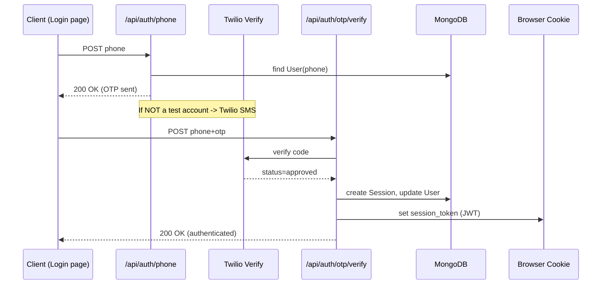

# Authentication & Session Management

This project authenticates **phone-number–based users** with a **One-Time Password (OTP)** flow backed by Twilio Verify, JWT cookies, and MongoDB.

---

## 1. Data Models (MongoDB / Mongoose)

| Model | Purpose | Key Fields |
|-------|---------|-----------|
| `User` | Stores all authorised phone numbers. | `phone`, `isAuthorized`, `role`, `profile`, `otpSecret`, `otpExpiry`, `lastLogin` |
| `Session` | Tracks every active JWT issued. | `phoneNumber`, `jwtId`, `isActive`, `ipAddress`, `userAgent`, `createdAt`, `lastAccessedAt` |

> `User` must have `isAuthorized: true` **or** be whitelisted to request an OTP.

---

## 2. Login Workflow

### Detailed Steps
1. **Request OTP** – `POST /api/auth/phone`
   1. Looks up `User` by `phone`. Rejects if not authorised.
   2. For *test* accounts (`user.isTestAccount` or hard-coded `+1 650-555-3434`), writes a mock OTP `123456` and skips Twilio.
   3. Otherwise: generates a random 6-digit OTP, stores it in `otpSecret/otpExpiry`, then (TODO) calls Twilio Verify to send SMS.

2. **Verify OTP** – `POST /api/auth/otp/verify`
   1. Calls Twilio Verify to confirm code.
   2. On success: generates a 7-day JWT (`jwtid = uuidv4()`), saves a `Session` document, and returns it as an **HTTP-only cookie** `session_token`.

3. **Legacy / Local Verify** – `POST /api/auth/verify`
   *Purely checks* `otpSecret` + `otpExpiry` in the `User` document (useful for local development without Twilio).

4. **Logout** – `POST /api/auth/logout`
   1. Reads `session_token`, decodes `jwtid`, marks the matching `Session` `isActive=false`.
   2. Clears the cookie.

---

## 3. Session Management

* JWT payload: `{ phone }` with `jwtid` (JTI) claim.
* Cookie name: **`session_token`** (http-only, secure in production, 7-day max-age).
* Each `Session` row allows auditing concurrent logins; business logic may invalidate old sessions if duplicates are detected.

---

## 4. Creating / Authorising Users

* Users **cannot self-register**.
* Admin UI (`/app/admin/users`) or `POST /api/users` adds a `User` document and automatically sets `isAuthorized: true`.
* Optional `isTestAccount` flag enables fixed OTP (`123456`).

---

## 5. Environment Variables

| Variable | Description |
|----------|-------------|
| `TWILIO_ACCOUNT_SID` | Twilio account SID |
| `TWILIO_AUTH_TOKEN` | Twilio auth token |
| `TWILIO_VERIFY_SERVICE_SID` | Twilio Verify service ID |
| `JWT_SECRET` | Secret used to sign JWTs |

Missing Twilio vars cause `/api/auth/otp/*` routes to return **500**; authentication still works with the legacy `/api/auth/phone` + `/api/auth/verify` flow.

---

## 6. Troubleshooting

| Symptom | Likely Cause | Fix |
|---------|--------------|-----|
| OTP never arrives | Twilio vars missing / number not in Verify Service | Check `.env` & Twilio dashboard |
| "Phone number not authorised" | `User` not in DB or `isAuthorized=false` | Add via admin page or set flag true |
| Concurrent session warning | Same account logged in elsewhere | Decide whether to invalidate old sessions |

---

## 7. Future Improvements

* Hash `otpSecret` before saving.
* Automatically invalidate previous sessions on new login.
* Add refresh-token flow to prolong sessions securely.
* Rate-limit OTP requests per phone/IP.
