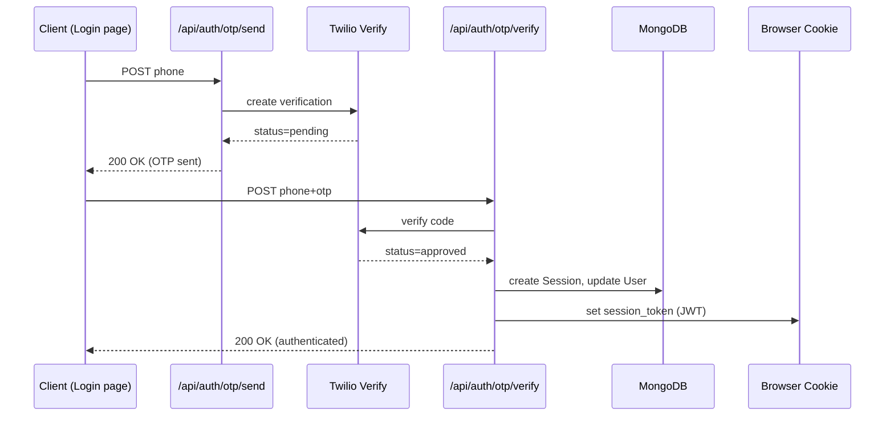

# Authentication & Session Management

This project authenticates **phone-number–based users** with a **One-Time Password (OTP)** flow backed by Twilio Verify, JWT cookies, and MongoDB.

---

## 1. Data Models (MongoDB / Mongoose)

| Model | Purpose | Key Fields |
|-------|---------|-----------|
| `User` | Stores all authorised phone numbers. | `phone`, `isAuthorized`, `role`, `profile`, `otpSecret`, `otpExpiry`, `lastLogin` |
| `Session` | Tracks every active JWT issued. | `phoneNumber`, `jwtId`, `isActive`, `ipAddress`, `userAgent`, `createdAt`, `lastAccessedAt` |

> `User` must have `isAuthorized: true` **or** be whitelisted to request an OTP.

---

## 2. Login Workflow

### Detailed Steps
1. **Request OTP** – `POST /api/auth/otp/send`
   1. Checks if the provided `phone` number is in a hard-coded `ALLOWED_PHONE_NUMBERS` array.
   2. If authorized, it calls the Twilio Verify service to send an SMS with an OTP to the user's phone.
   3. For test numbers, the Twilio service is configured to use a mock OTP (`123456`) instead of sending a real SMS.

2. **Verify OTP** – `POST /api/auth/otp/verify`
   1. Calls the Twilio Verify service to check if the provided `otp` is correct for the given `phone` number.
   2. On success, it generates a 7-day JWT (`jwtid = uuidv4()`), saves a `Session` document to the database, and returns the token as an **HTTP-only cookie** named `session_token`.

3. **Logout** – `POST /api/auth/logout`
   1. Reads `session_token`, decodes `jwtid`, marks the matching `Session` `isActive=false`.
   2. Clears the cookie.

---

## 3. Session Management

* JWT payload: `{ phone }` with `jwtid` (JTI) claim.
* Cookie name: **`session_token`** (http-only, secure in production, 7-day max-age).
* Each `Session` row allows auditing concurrent logins; business logic may invalidate old sessions if duplicates are detected.

---

## 4. Creating / Authorising Users

An **admin console** is available at `/admin/users` and is visible only when the logged-in phone number is `+27720560090` (checked server-side by middleware).

From this console the admin can:
1. View existing users in a list.
2. Add users via a form that captures Name, Surname, Position, Department (`new`/`used`), and Mobile Number.
   * All fields are mandatory except `position` (may be left blank).
   * New users are created with `isAuthorized:true` so they can immediately request OTP.

New user data fields:
| Field | Schema path |
|-------|-------------|
| Name | `profile.firstName` |
| Surname | `profile.lastName` |
| Position | `position` |
| Department | `department` *(enum new/used)* |
| Mobile | `phone` |

Creation is restricted to the admin phone; route `/api/users` validates this via the `x-user-phone` header set by authentication middleware.

---

## 5. Session & Device Rules

1. **OTP Window** – Each device requires OTP verification once every **24 h**. After that, any request will redirect to the login screen to re-enter the OTP.
2. **Device Limit** – A user may have at most **2 active sessions**:
   * 1 `mobile` (Android / iOS User-Agent)
   * 1 `desktop` (other UA)
   * When logging in on a second device of the same type, the **oldest** active session of that type is deactivated.
   * Logging in on a third device (two different types already active) is blocked.
3. **Session Storage** – `Session` model now stores:
   * `deviceType` (`mobile` / `desktop`)
   * `lastOtpAt` – timestamp of last OTP success
   * `expiresAt` – 24 h after `lastOtpAt`
4. **Middleware Enforcement** – `middleware.tsx` checks JWT & session record on every request:
   * If `expiresAt` ≤ now ⇒ session deactivated, redirect to `/auth/login`.
   * Otherwise request proceeds, with `x-user-phone` and `x-device-type` headers attached.
5. **Cleanup Job** – `/api/cron/cleanup-sessions` deactivates any session past `expiresAt`; schedule daily via hosting provider.

---

## 6. Codebase Conventions

To improve code quality and maintainability, this project has been standardized to use **TypeScript** for all frontend components.

- All new pages and components must use the `.tsx` file extension.
- The main login page, for example, is located at `app/auth/login/page.tsx`.

* Users **cannot self-register**.
* Admin UI (`/app/admin/users`) or `POST /api/users` adds a `User` document and automatically sets `isAuthorized: true`.
* Optional `isTestAccount` flag enables fixed OTP (`123456`).

---

## 5. Environment Variables

| Variable | Description |
|----------|-------------|
| `TWILIO_ACCOUNT_SID` | Twilio account SID |
| `TWILIO_AUTH_TOKEN` | Twilio auth token |
| `TWILIO_VERIFY_SERVICE_SID` | Twilio Verify service ID |
| `JWT_SECRET` | Secret used to sign JWTs |

Missing Twilio vars cause `/api/auth/otp/*` routes to return **500**; authentication still works with the legacy `/api/auth/phone` + `/api/auth/verify` flow.

---

## 6. Troubleshooting

| Symptom | Likely Cause | Fix |
|---------|--------------|-----|
| OTP never arrives | Twilio vars missing / number not in Verify Service | Check `.env` & Twilio dashboard |
| "Phone number not authorised" | `User` not in DB or `isAuthorized=false` | Add via admin page or set flag true |
| Concurrent session warning | Same account logged in elsewhere | Decide whether to invalidate old sessions |

---

## 7. Future Improvements

* Hash `otpSecret` before saving.
* Automatically invalidate previous sessions on new login.
* Add refresh-token flow to prolong sessions securely.
* Rate-limit OTP requests per phone/IP.
