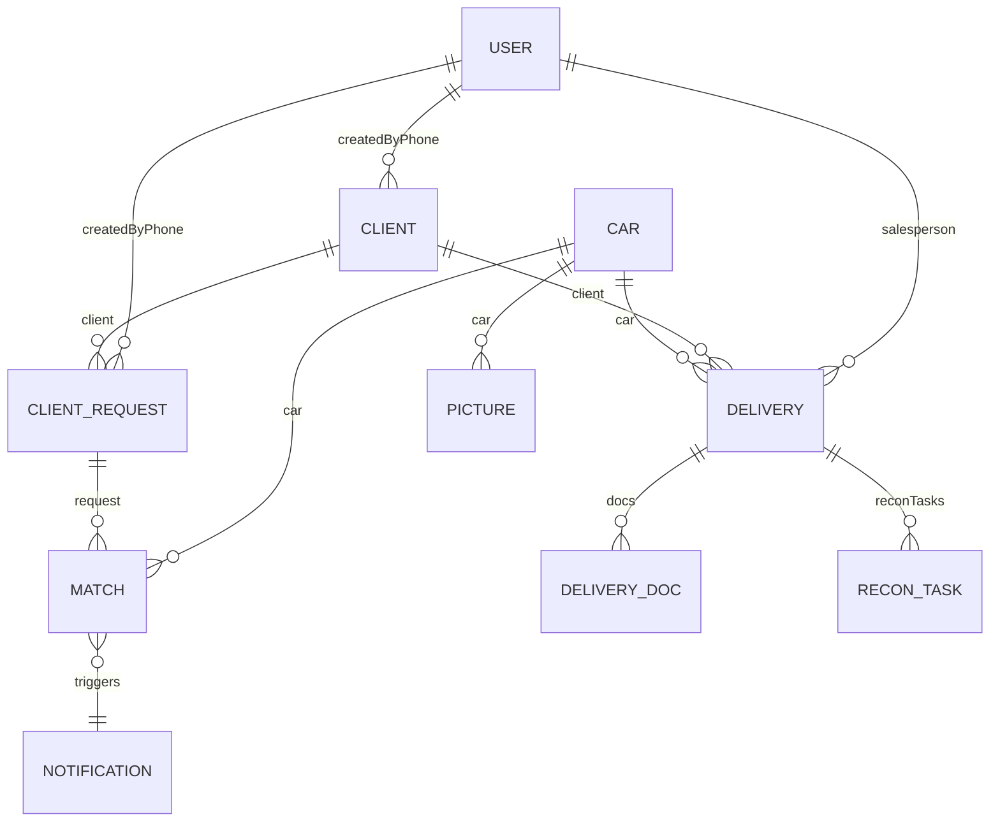

# Main Integration Specification

## System Architecture Overview

MCinv02 is a sophisticated car inventory management system built with Next.js 15 and TypeScript, featuring AI-powered matching, comprehensive user isolation, and extensive performance optimizations. The system enables car dealerships to manage inventory, clients, and deliveries with intelligent automation.

## High-Level Architecture

```
┌─────────────────────────────────────────────────────────────────┐
│                    Next.js 15 Application                        │
├─────────────────────────────────────────────────────────────────┤
│  ┌─────────────┐  ┌─────────────┐  ┌─────────────┐  ┌─────────┐ │
│  │   React     │  │  Next.js    │  │ TypeScript  │  │ Tailwind│ │
│  │ Components  │  │   API       │  │   Types     │  │   CSS   │ │
│  │             │  │  Routes     │  │             │  │         │ │
│  └─────────────┘  └─────────────┘  └─────────────┘  └─────────┘ │
├─────────────────────────────────────────────────────────────────┤
│  ┌─────────────┐  ┌─────────────┐  ┌─────────────┐  ┌─────────┐ │
│  │  MongoDB    │  │  Gemini     │  │  Twilio     │  │   R2    │ │
│  │  Database   │  │   AI        │  │   SMS       │  │ Storage │ │
│  └─────────────┘  └─────────────┘  └─────────────┘  └─────────┘ │
└─────────────────────────────────────────────────────────────────┘
```

## Core Technology Stack

### Frontend Technologies
- **Framework**: Next.js 15.2.4 with React 19
- **Language**: TypeScript 5.0
- **Styling**: Tailwind CSS with custom design system
- **UI Components**: Radix UI primitives with custom styling
- **State Management**: React state with context patterns
- **Form Handling**: React Hook Form with Zod validation

### Backend Technologies
- **Runtime**: Node.js with Next.js API routes
- **Database**: MongoDB 6.17.0 with Mongoose 8.16.0 ODM
- **Authentication**: JWT tokens with HTTP-only cookies
- **External APIs**: Twilio SMS, Google Gemini API

### Data Storage and Processing
- **Primary Database**: MongoDB for application data
- **File Storage**: Cloudflare R2/S3 for images and documents
- **AI Processing**: Google Gemini parsing for structured request filters
- **Matching Engine**: Deterministic scoring for car/request matching

## Feature Integration Architecture

### 1. Cars Management Integration

#### Data Flow
```
Car Creation → Image Processing → Cloud Storage → Scheduled Matching
     ↓              ↓               ↓                  ↓
Image Upload → Sharp Resize → R2 Upload → Score Against Requests → Match Creation
```

#### Integration Points
- **Delivery Auto-Creation**: Status change to "reserved" triggers delivery record
- **Matching Engine**: New cars are considered by scheduled matching against active requests
- **Image Pipeline**: Automatic optimization and cloud storage upload

### 2. Clients & Requests Integration

#### Data Flow
```
Client Creation → Notes Parsing → Structured Filters → Matching → Match Creation
     ↓                ↓                ↓               ↓           ↓
User Input → Gemini AI → Saved Filters → Scoring Engine → Match Creation
```

#### Integration Points
- **AI-Powered Parsing**: Natural language notes automatically converted to structured requests
- **Scoring-Based Matching**: Requests matched against car inventory via deterministic scoring
- **Notification Generation**: New matches trigger user notifications

### 3. Deliveries & Recon Integration

#### Data Flow
```
Car Reserved → Delivery Created → Recon Tasks → Document Upload → Completion
     ↓              ↓              ↓             ↓              ↓
Status Update → User Assignment → Task Tracking → File Storage → Status Update
```

#### Integration Points
- **Car Status Sync**: Delivery progress reflected in car status
- **Document Management**: Dual storage (local + cloud) with offline support
- **User Assignment**: Deliveries tied to specific salesperson accounts

### 4. Notifications & Matching Integration

#### Data Flow
```
Match Created → Score Calculated → Explanation Generated → Notification Sent
     ↓              ↓                   ↓                    ↓
Scoring Engine → Match Score → Score Breakdown → User Alert → Status Tracking
```

#### Integration Points
- **Explainable Scoring**: Matches store a score breakdown for transparency
- **Status Lifecycle**: New → Notified → Viewed → Dismissed → Converted tracking
- **User Isolation**: Users only see matches for their own requests

### 5. User Isolation & Authentication Integration

#### Authentication Flow
```
Phone Entry → SMS OTP → JWT Token → Session Cookie → Request Filtering
     ↓           ↓         ↓           ↓             ↓
User Input → Twilio → Jose Sign → HTTP-Only → Header Injection
```

#### Integration Points
- **Data Filtering**: All API responses filtered by user ownership
- **Cross-User AI**: Matching operates across all users while maintaining privacy
- **Role-Based Access**: Admin/Manager/User permission levels

### 6. AI Parsing & Matching Integration

#### Parsing + Scoring Pipeline
```
Text Input → Gemini Parsing → Structured Filters → Scoring Engine → Match Creation
     ↓            ↓                ↓                ↓              ↓
Raw Text → JSON Criteria → Saved Filters → Score (0-100) → VehicleMatch Records
```

#### Integration Points
- **Bidirectional Matching**: Cars and requests are evaluated against each other via scoring
- **Scheduled Updates**: Cron endpoints handle parsing/matching on a schedule
- **Fallback Support**: Graceful degradation when AI services are unavailable

### 7. Performance Optimizations Integration

#### Optimization Layers
```
Bundle Splitting → Lazy Loading → Image Optimization → API Parallelization
     ↓                ↓               ↓                   ↓
Dynamic Imports → Suspense → Sharp Processing → Promise.all()
```

#### Integration Points
- **Component Loading**: Heavy components loaded on-demand
- **Image Pipeline**: Automatic optimization during car creation
- **Data Fetching**: Parallel API calls for dashboard loading

## Data Relationships and Flow

### Entity Relationship Diagram



### Data Flow Architecture

#### Car Inventory Workflow
1. **Creation**: Car added with images and specifications
2. **Storage**: Images stored in R2 and metadata stored in MongoDB
3. **Matching**: Scheduled scoring against all active client requests
4. **Notification**: Relevant matches trigger user notifications

#### Client Request Workflow
1. **Creation**: Client created with natural language requirements
2. **Parsing**: AI extracts structured filters from notes
3. **Matching**: Score against available car inventory
4. **Results**: Matches presented to user with explanations

#### Delivery Management Workflow
1. **Initiation**: Car reservation triggers delivery creation
2. **Assignment**: Delivery linked to specific salesperson
3. **Tracking**: Recon tasks and document requirements managed
4. **Completion**: Delivery completion updates car status

## Technology Integration Details

### AI Integration Architecture

#### Gemini Service Integration
- **Model**: `gemini-1.5-flash` for structured request parsing
- **Output**: JSON filters + confidence score

#### Deterministic Matching Engine
- **Scoring**: Weighted 0-100 score based on filters and vehicle attributes
- **Storage**: Matches stored in MongoDB (`VehicleMatch`)

### Database Integration Strategy

#### MongoDB Schema Design
- **User Isolation**: `createdByPhone` field on clients and requests
- **Flexible Schemas**: JSON fields for variable data structures
- **Indexing Strategy**: Optimized indexes for common query patterns

#### Data Consistency Management
- **Atomic Operations**: Multi-document transactions for data consistency
- **Audit Logging**: All changes tracked with user and timestamp
- **Soft Deletes**: Active/inactive flags rather than physical deletion

### External Service Integration

#### Cloud Storage (R2/S3)
- **Image Pipeline**: Automatic resizing and format optimization
- **Document Storage**: Secure storage for delivery documents
- **CDN Integration**: Fast global content delivery

#### SMS Service (Twilio)
- **OTP Delivery**: Secure authentication code delivery
- **Fallback Handling**: Retry logic for delivery failures
- **International Support**: South African phone number formatting

## Performance Considerations

### Loading Performance Optimizations
- **Critical Path Optimization**: Cars load first, then secondary data
- **Image Optimization**: Automatic WebP conversion and resizing
- **Bundle Splitting**: Dynamic imports for faster initial loads

### Runtime Performance Optimizations
- **Component Memoization**: Expensive calculations cached
- **Virtual Scrolling**: Large lists rendered efficiently
- **Debounced Inputs**: Search and filter operations optimized

### Scalability Considerations
- **Database Indexing**: Optimized for growth in car/client data
- **Matching Performance**: Scheduled batch processing and query optimization
- **API Rate Limiting**: Protection against abuse and cost control

## Security Architecture

### Authentication and Authorization
- **JWT Strategy**: Stateless token-based authentication
- **Phone-Based Isolation**: Complete data segregation by user
- **Role-Based Access**: Granular permissions for different user types

### Data Protection
- **Input Validation**: Zod schemas for all API endpoints
- **SQL Injection Prevention**: MongoDB with parameterized queries
- **XSS Protection**: React's built-in XSS prevention

### Privacy and Compliance
- **GDPR Considerations**: User data isolation and deletion capabilities
- **Data Minimization**: Only necessary data collected and stored
- **Audit Trails**: Complete logging of all data access and changes

## Deployment and DevOps

### Application Deployment
- **Platform**: Next.js optimized for serverless deployment
- **Environment Management**: Separate configs for development/staging/production
- **Secret Management**: Secure handling of API keys and credentials

### Monitoring and Observability
- **Error Tracking**: Comprehensive error logging and monitoring
- **Performance Monitoring**: Real-time performance metrics
- **Usage Analytics**: Feature usage and user behavior tracking

## Potential Areas for Expansion

### Advanced AI Features
- **Predictive Pricing**: AI-powered price optimization
- **Demand Forecasting**: Market demand prediction
- **Automated Valuation**: Vehicle appraisal assistance

### Enhanced User Experience
- **Mobile App**: Native mobile application development
- **Advanced Search**: Faceted search with more filter options
- **Reporting Dashboard**: Business intelligence and analytics

### System Scalability
- **Multi-Region Deployment**: Global expansion support
- **Advanced Caching**: Redis integration for improved performance
- **Microservices Architecture**: Modular service separation

## Known Limitations and Constraints

### Current System Boundaries
- **Geographic Focus**: Primarily designed for South African market
- **Vehicle Types**: Currently optimized for passenger vehicles
- **User Scale**: Designed for small to medium dealership operations

### Technical Constraints
- **AI Service Dependency**: Reliance on external Gemini parsing (optional)
- **Real-time Requirements**: Some operations may have sub-second latency

### Business Constraints
- **Regulatory Compliance**: Designed for South African regulatory environment
- **Industry Focus**: Tailored for automotive retail operations
- **Pricing Model**: Cost-effective for small to medium businesses

## Conclusion

MCinv02 represents a comprehensive car inventory management solution that successfully integrates modern web technologies with advanced AI capabilities. The system provides a solid foundation for automotive retail operations while offering clear paths for future enhancement and scaling.

The architecture emphasizes modularity, performance, and user experience while maintaining the flexibility to adapt to changing business requirements and technological advancements.
