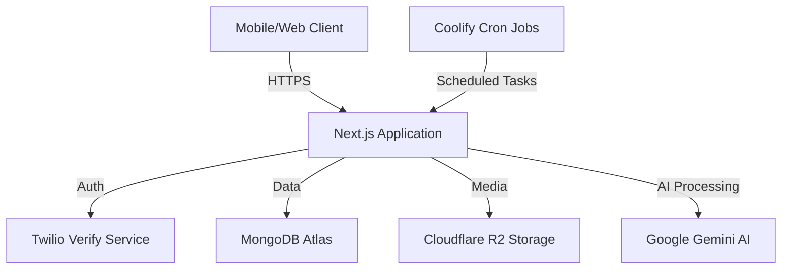

# Technology Stack & Architecture

## Architecture Overview
The application follows a modern **Monolithic** architecture using the **Next.js App Router**. This provides a unified codebase for both the frontend UI and the backend API, simplifying deployment, type safety, and maintenance.

### High-Level Diagram

## Core Technologies

### Frontend (User Experience)
*   **Framework**: Next.js 15 (App Router)
*   **Library**: React 19
*   **Language**: TypeScript (Strict mode enabled)
*   **Styling**: TailwindCSS (Utility-first CSS)
*   **Components**: shadcn/ui (Accessible, customizable components based on Radix UI)
*   **Icons**: Lucide React
*   **State Management**: React Hooks + Server Components

### Backend (API & Logic)
*   **Runtime**: Node.js (via Next.js Route Handlers)
*   **Database**: MongoDB (v6+) with Mongoose ODM
*   **Authentication**: Custom implementation using Twilio Verify (SMS OTP) and HTTP-only JWT cookies.
*   **Storage**: Cloudflare R2 (S3-compatible object storage) for cost-effective, zero-egress fee image hosting.
*   **Image Processing**: `sharp` for server-side image resizing and optimization before storage.

### AI & Automation
*   **LLM Provider**: Google Gemini 1.5 Flash
    *   *Usage*: Natural language parsing, structured data extraction, marketing copy generation.
    *   *Cost Efficiency*: Chosen for its extremely low cost-per-token compared to GPT-4, making the AI features sustainable at scale.
*   **Background Jobs**: API-triggered cron jobs (secured via `CRON_SECRET`) managed by the hosting platform (Coolify).

## Infrastructure & DevOps

### Deployment
*   **Platform**: optimized for **Coolify** (Self-hosted PaaS) but compatible with Vercel, Netlify, or any Docker container environment.
*   **Containerization**: Standard Node.js container support.

### Security Implementation
*   **Authentication**: Passwordless, OTP-based login (high security, low friction).
*   **RBAC**: Middleware-enforced Role-Based Access Control (`admin`, `manager`, `sales`, `recon`).
*   **Data Isolation**: Row-level security logic ensuring sales agents only access their own client data.
*   **Headers**: Secure HTTP headers, strict CORS policies.

### Quality Assurance
*   **Testing Framework**: Jest
*   **Integration Testing**: `mongodb-memory-server` for true database integration tests without external dependencies.
*   **CI/CD**: GitHub Actions workflows for automated linting, type-checking, and testing on every push.

## Codebase Stats
*   **Language**: 100% TypeScript
*   **Test Coverage**: Key business logic (Pricing, Matching, Auth) fully tested.
*   **Linting**: ESLint with strict configuration.

## Key Architectural Benefits
1.  **Zero-DevOps Maintenance**: Serverless-ready architecture means no complex server management.
2.  **Cost efficiency**: Uses Cloudflare R2 (zero egress fees) and Gemini Flash (low API costs) to keep operating costs minimal (~$10-20/month for small-medium dealers).
3.  **Scalability**: Stateless application logic allows for horizontal scaling. Database handles the state.
